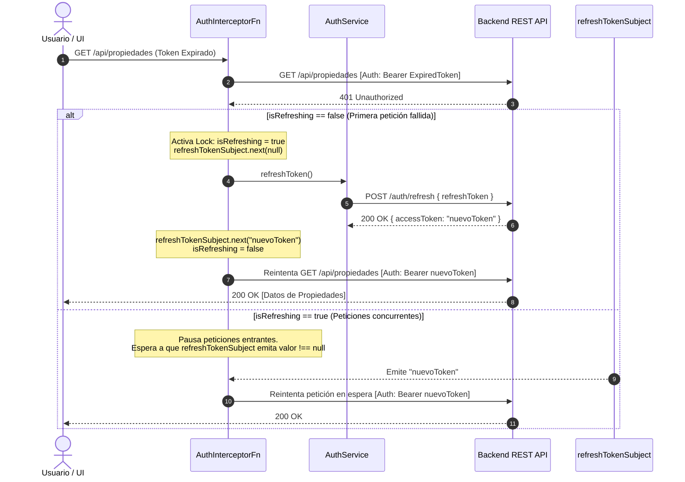
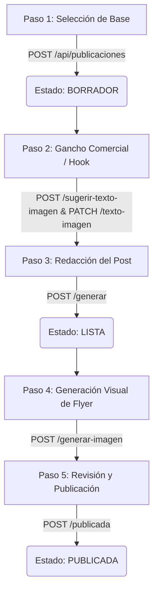

# 🏛️ InmoMarketing - Especificación Técnica y Arquitectura de Software Frontend

> **Versión:** 1.0.0  
> **Estado:** Fase 0 - Documentación y Especificación de Ingeniería  
> **Stack Objetivo:** Angular 22+ (Standalone Components, Signals, Reactive Forms, Modern Control Flow) & Tailwind CSS  
> **Backend de Referencia:** Spring Boot REST API (`https://github.com/marianoqqq/Marketing-Gestor`)  

---

## 📑 Tabla de Contenidos
1. [Visión General y Objetivos del Sistema](#1-visión-general-y-objetivos-del-sistema)
2. [Requisitos del Sistema (61 Requisitos: 55 RF + 6 RNF)](#2-requisitos-del-sistema)
   - [2.1 Requisitos Funcionales (RF)](#21-requisitos-funcionales-rf)
   - [2.2 Requisitos No Funcionales (RNF)](#22-requisitos-no-funcionales-rnf)
3. [Catálogo de Librerías Complementarias, UI/UX, Audio y Motion (Gestión con Bun)](#3-catálogo-de-librerías-complementarias-uiux-audio-y-motion-gestión-con-bun)
   - [3.1 Tipografía y Rendimiento Visual (Google Fonts Inter)](#31-tipografía-y-rendimiento-visual-google-fonts-inter)
   - [3.2 Microinteracciones Auditivas (Howler.js)](#32-microinteracciones-auditivas-howlerjs)
   - [3.3 Animaciones Fluidas y Transiciones (Motion / Canvas Confetti)](#33-animaciones-fluidas-y-transiciones-motion--canvas-confetti)
   - [3.4 Decodificación Segura de Tokens JWT (jwt-decode)](#34-decodificación-segura-de-tokens-jwt-jwt-decode)
   - [3.5 Carga Multimedia Drag & Drop: FilePond vs ngx-dropzone](#35-carga-multimedia-drag--drop-filepond-vs-ngx-dropzone)
   - [3.6 Iconografía Oficial (Google Material Symbols)](#36-iconografía-oficial-google-material-symbols)
   - [3.7 Exportación de Flyers a Imagen (html-to-image)](#37-exportación-de-flyers-a-imagen-html-to-image)
   - [3.8 Utilidades Nativas de Google (@angular/cdk)](#38-utilidades-nativas-de-google-angularcdk)
   - [3.9 Desplazamiento Cinemático (Lenis Smooth Scroll)](#39-desplazamiento-cinemático-lenis-smooth-scroll)
   - [3.10 Notificaciones Toast Premium (Ngx-Sonner)](#310-notificaciones-toast-premium-ngx-sonner)
   - [3.11 Comandos de Instalación y Administración con Bun](#311-comandos-de-instalación-y-administración-con-bun)
4. [Guía de Implementación para Desafíos Técnicos Críticos](#4-guía-de-implementación-para-desafíos-técnicos-críticos)
   - [4.1 Flujo JWT Stateless, Concurrencia y Renovación con RxJS](#41-flujo-jwt-stateless-concurrencia-y-renovación-con-rxjs)
   - [4.2 Detección y Manejo Amigable del Cold Start de Render Free](#42-detección-y-manejo-amigable-del-cold-start-de-render-free)
   - [4.3 Renderizado de Imágenes Protegidas en Cloudflare R2 (`AuthImagePipe`)](#43-renderizado-de-imágenes-protegidas-en-cloudflare-r2-authimagepipe)
   - [4.4 Carga Drag & Drop Múltiple Multipart (`FormData`)](#44-carga-drag--drop-múltiple-multipart-formdata)
   - [4.5 Tratamiento de Query Params en Solicitudes PATCH](#45-tratamiento-de-query-params-en-solicitudes-patch)
5. [Modelos de Datos Completos (TypeScript Interfaces y Enums)](#5-modelos-de-datos-completos-typescript-interfaces-y-enums)
6. [Catálogo Completo de Endpoints de la API](#6-catálogo-completo-de-endpoints-de-la-api)
   - [6.1 Autenticación (`/auth`)](#61-autenticación-auth)
   - [6.2 Propiedades (`/api/propiedades`)](#62-propiedades-apipropiedades)
   - [6.3 Fotografías y Archivos (`/api/propiedades/{id}/fotos`, `/api/archivos/{id}`)](#63-fotografías-y-archivos-apipropiedadesidfotos-apiarchivosid)
   - [6.4 Publicaciones e Inteligencia Artificial (`/api/publicaciones`)](#64-publicaciones-e-inteligencia-artificial-apipublicaciones)
   - [6.5 Administración (`/api/admin`)](#65-administración-apiadmin)
7. [Estructura de Navegación, Rutas y Guards de Seguridad](#7-estructura-de-navegación-rutas-y-guards-de-seguridad)
8. [Diseño Detallado del Flujo Estrella: "Wizard Creador de Anuncios con IA"](#8-diseño-detallado-del-flujo-estrella-wizard-creador-de-anuncios-con-ia)

---

## 1. Visión General y Objetivos del Sistema

**InmoMarketing** es una solución SaaS B2B **multi-tenant** desarrollada para optimizar la presencia digital y el marketing de inmobiliarias y corredores inmobiliarios independientes. El sistema resuelve la brecha entre el inventario inmobiliario tradicional y la generación ágil de contenido comercial de alto impacto para redes sociales.

### Los 3 Pilares Fundamentales:
1. **Gestión Inmobiliaria y Galería Multimedia:** CRUD exhaustivo de inmuebles residenciales y comerciales con almacenamiento binario distribuido en **Cloudflare R2**, garantizando persistencia veloz, segura y de bajo costo.
2. **Generador Asistido de Publicaciones con IA (Core de Valor):**
   - **Groq (Llama 3 / GPT-OSS):** Redacción instantánea de textos persuasivos adaptados a los algoritmos y audiencias de Instagram y Facebook, con inclusión inteligente de emojis, llamadas a la acción (CTA) y hashtags de conversión.
   - **Ganchos Publicitarios (Flyer Hooks):** Sugerencia automatizada de copys cortos y contundentes para el encabezado de flyers promocionales.
   - **OpenAI (DALL-E / GPT-Image):** Generación y estilizado de flyers visuales publicitarios en formato imagen listos para publicar o descargar.
3. **Panel de Control y Gobierno Multi-Inquilino:** Consola para administradores (`ROLE_ADMIN`) orientada a auditar inmobiliarias, monitorear la actividad de usuarios y aplicar bloqueos preventivos de acceso.

---

## 2. Requisitos del Sistema

### 2.1 Requisitos Funcionales (RF) - 55 Requisitos

#### Módulo 1: Autenticación, Perfil y Preferencias de Usuario (AUTH)
- **RF-AUTH-01 (Registro Inicial de Usuario e Inmobiliaria):** El sistema debe permitir registrar una nueva cuenta de agente inmobiliario ingresando nombre, correo electrónico y contraseña, asociando simultáneamente el nombre de la inmobiliaria a la que pertenece.
- **RF-AUTH-02 (Inicio de Sesión):** Los usuarios registrados deben poder iniciar sesión ingresando sus credenciales (correo electrónico y contraseña), accediendo al espacio de trabajo de su inmobiliaria.
- **RF-AUTH-03 (Renovación Silenciosa de Sesión):** El sistema debe mantener activa la sesión del usuario de forma automática y transparente mientras continúe operando en la plataforma, renovando las credenciales vencidas sin interrumpir sus tareas ni exigir un nuevo ingreso manual.
- **RF-AUTH-04 (Cierre Voluntario de Sesión):** El usuario debe poder cerrar su sesión de manera voluntaria en cualquier momento, revocando el acceso en el dispositivo y redirigiendo a la pantalla de ingreso.
- **RF-AUTH-05 (Control de Roles y Permisos):** El sistema debe diferenciar perfiles con capacidades operativas distintas: usuarios estándar (agentes inmobiliarios) y administradores globales de la plataforma.
- **RF-AUTH-06 (Restricción por Estado de Usuario):** El sistema debe impedir el acceso a aquellos usuarios que hayan sido inhabilitados o suspendidos por un administrador, informando la causa del bloqueo.
- **RF-AUTH-07 (Persistencia y Restauración de Sesión):** Al recargar la página o volver a ingresar al navegador, el sistema debe recordar la sesión activa del usuario sin requerir reautenticación si la sesión sigue vigente.
- **RF-AUTH-08 (Gestión y Actualización de Perfil):** El usuario debe poder visualizar y editar sus datos personales básicos (nombre completo y contraseña de acceso).
- **RF-AUTH-09 (Preferencias de Interfaz y Accesibilidad Sensorial):** El usuario debe contar con controles de personalización para alternar entre tema claro y tema oscuro, así como activar o silenciar los efectos sonoros de la plataforma.
- **RF-AUTH-10 (Cierre de Sesión por Inactividad Prolongada):** El sistema debe finalizar la sesión automáticamente si detecta inactividad del usuario por un periodo prolongado, solicitando reautenticación para salvaguardar la privacidad de los datos inmobiliarios.

#### Módulo 2: Gestión de Propiedades Inmobiliarias (PROP)
- **RF-PROP-01 (Visualización de Catálogo de Inmuebles):** El sistema debe mostrar el listado de propiedades asociadas exclusivamente a la inmobiliaria del usuario autenticado.
- **RF-PROP-02 (Búsqueda y Filtrado de Inmuebles):** El usuario debe poder filtrar y buscar propiedades por tipo de inmueble (casa, departamento, ph, terreno, local), tipo de operación comercial (venta, alquiler) y estado comercial (disponible, reservada, vendida).
- **RF-PROP-03 (Alta de Nueva Propiedad):** El sistema debe proveer un formulario para dar de alta una propiedad registrando título, tipo de inmueble, tipo de operación, precio comercial, dirección física, cantidad de ambientes, metros cuadrados totales y descripción detallada.
- **RF-PROP-04 (Ficha Técnica y Detalle de Inmueble):** El sistema debe exhibir una vista detallada de la propiedad con todas sus características constructivas, comerciales y su galería de fotografías asociadas.
- **RF-PROP-05 (Modificación de Propiedad):** El usuario debe poder editar la información, precios y condiciones comerciales de cualquier propiedad perteneciente a su inmobiliaria.
- **RF-PROP-06 (Baja de Propiedad):** El usuario debe poder eliminar una propiedad de su catálogo, solicitando una confirmación previa para evitar pérdidas accidentales.
- **RF-PROP-07 (Ordenamiento Dinámico del Catálogo):** El usuario debe poder ordenar el listado de propiedades por precio ascendente o descendente, fecha de creación o superficie cubierta.
- **RF-PROP-08 (Cálculo del Valor por Superficie):** El sistema debe calcular y mostrar automáticamente el costo por metro cuadrado para orientar las tasaciones y comparativas comerciales.
- **RF-PROP-09 (Selección de Fotografía de Portada):** El usuario debe poder definir cuál fotografía de la galería funcionará como portada representativa en las tarjetas del catálogo.
- **RF-PROP-10 (Visualizador Ampliado de Fotografías):** El sistema debe permitir abrir un visualizador en pantalla completa (modo galería / zoom) para examinar los detalles de las fotografías en alta resolución.

#### Módulo 3: Galería Multimedia y Almacenamiento (MED)
- **RF-MED-01 (Carga Múltiple de Fotografías):** El sistema debe permitir cargar varias fotografías simultáneamente para un inmueble mediante arrastrar y soltar o mediante explorador de archivos.
- **RF-MED-02 (Validación de Archivos Multimedia):** El sistema debe comprobar antes del envío que las imágenes no superen el peso máximo permitido (5 megabytes) y pertenezcan a formatos de imagen válidos (JPEG, PNG o WebP).
- **RF-MED-03 (Almacenamiento y Asociación de Fotos):** Las fotografías aprobadas deben enviarse y asociarse de manera permanente al catálogo multimedia del inmueble seleccionado.
- **RF-MED-04 (Visualización de Galería de Fotos):** El usuario debe poder visualizar en alta calidad el carrusel o cuadrícula de fotos cargadas para cada propiedad.
- **RF-MED-05 (Acceso Seguro a Fotografías):** El sistema debe garantizar que las imágenes de las propiedades solo puedan ser visualizadas y descargadas por usuarios autorizados de la plataforma.
- **RF-MED-06 (Selección de Fotografías para Campañas):** El usuario debe poder elegir una o varias fotos del inmueble para incorporarlas como material gráfico en las publicaciones de redes sociales.
- **RF-MED-07 (Eliminación Individual de Fotografías):** El usuario debe poder remover fotografías puntuales de la galería de una propiedad sin alterar el resto de las imágenes.
- **RF-MED-08 (Descarga de Archivos Originales):** El usuario debe poder descargar las fotografías originales en alta definición a su dispositivo local.
- **RF-MED-09 (Monitoreo Visual del Progreso de Subida):** Durante la carga de múltiples imágenes, el sistema debe informar el avance porcentual individual y global de la transferencia.

#### Módulo 4: Generador de Publicaciones y Asistencia con Inteligencia Artificial (PUB)
- **RF-PUB-01 (Tablero de Publicaciones):** El sistema debe listar todas las publicaciones generadas por la inmobiliaria, permitiendo identificarlas por su estado (borrador, lista para publicar, publicada o error).
- **RF-PUB-02 (Asistente de Creación y Configuración Inicial):** El sistema debe guiar al usuario para iniciar una campaña seleccionando la propiedad de referencia, las fotos a incluir, la red social de destino (Instagram o Facebook) y el formato del contenido (imagen comercial).
- **RF-PUB-03 (Generación de Ganchos Comerciales con IA):** El sistema debe permitir solicitar a la Inteligencia Artificial sugerencias automáticas de frases cortas de alto impacto publicitario para encabezar el anuncio o flyer.
- **RF-PUB-04 (Personalización de Gancho y Estilo Visual):** El usuario debe poder modificar manualmente el texto del gancho publicitario y definir las preferencias de estilo artístico para las imágenes.
- **RF-PUB-05 (Redacción Asistida de Textos y Copys):** El sistema debe redactar mediante Inteligencia Artificial el cuerpo completo de la publicación, adaptando el tono, las llamadas a la acción, los emoticones y los hashtags según la red social seleccionada (Instagram o Facebook) y las indicaciones brindadas por el usuario.
- **RF-PUB-06 (Copiado Rápido al Portapapeles):** El usuario debe contar con una acción rápida para copiar el texto generado directamente a su portapapeles con confirmación visual y auditiva sutil.
- **RF-PUB-07 (Contador y Validación de Longitud de Red Social):** El sistema debe computar en tiempo real los caracteres del copy y alertar visualmente cuando el texto exceda los límites recomendados o permitidos por la red social elegida.
- **RF-PUB-08 (Regeneración Parcial Asistida):** El usuario debe poder solicitar a la Inteligencia Artificial que regenere únicamente una sección del anuncio (por ejemplo, solo los hashtags o solo el cierre comercial) sin perder el cuerpo principal.
- **RF-PUB-09 (Diseño Automatizado de Flyers con IA):** El sistema debe permitir generar piezas gráficas publicitarias en formato imagen optimizadas comercialmente a partir de la descripción del inmueble y el estilo visual escogido.
- **RF-PUB-10 (Descarga de Material Promocional):** El usuario debe poder descargar las piezas gráficas generadas en alta resolución para su difusión en canales externos.
- **RF-PUB-11 (Maqueta Interactiva de Previsualización en Redes):** El sistema debe mostrar un simulador interactivo que reproduzca fidedignamente cómo lucirá el anuncio en el feed de Instagram o Facebook.
- **RF-PUB-12 (Seguimiento y Marcado de Publicación):** El sistema debe permitir al usuario registrar cuándo un anuncio ya ha sido compartido externamente, actualizando su estado a publicado e indicando la fecha y hora de la acción.
- **RF-PUB-13 (Celebración y Retroalimentación Sensorial al Publicar):** Al completar el ciclo de publicación, el sistema debe desplegar una microanimación celebratoria acompañada de un sonido armónico sutil para premiar el logro operativo.
- **RF-PUB-14 (Eliminación de Publicaciones):** El usuario debe poder descartar o borrar publicaciones obsoletas o no deseadas.

#### Módulo 5: Tablero de Control y Métricas Operativas (DASH)
- **RF-DASH-01 (Métricas de Cartera Inmobiliaria):** El sistema debe desplegar indicadores cuantitativos del inventario (total de propiedades disponibles, en proceso de reserva y vendidas).
- **RF-DASH-02 (Métricas de Productividad en Marketing):** El sistema debe mostrar gráficos o resúmenes del volumen de publicaciones concebidas durante el mes y su distribución por red social (Instagram y Facebook).
- **RF-DASH-03 (Accesos Directos Operativos):** El tablero debe contener botones de acceso rápido para iniciar el alta de propiedades o lanzar el asistente de creación de anuncios en un solo clic.
- **RF-DASH-04 (Historial de Actividad Reciente):** El sistema debe listar las últimas acciones registradas en la inmobiliaria (nuevos inmuebles ingresados, anuncios generados recientemente).

#### Módulo 6: Identidad y Perfil Corporativo de Inmobiliaria (INMO)
- **RF-INMO-01 (Visualización de Información Corporativa):** Los usuarios deben poder consultar los datos comerciales de su inmobiliaria (nombre, teléfono, cuenta de Instagram, dirección física y logotipo oficial).
- **RF-INMO-02 (Actualización de Perfil Corporativo):** Los agentes autorizados deben poder modificar los datos de contacto, redes sociales y logotipo de la inmobiliaria para sincronizarlos con la generación de anuncios.

#### Módulo 7: Administración Global de la Plataforma (ADM)
- **RF-ADM-01 (Auditoría de Inmobiliarias Registradas):** Los administradores deben poder visualizar un listado consolidado de todas las inmobiliarias que operan en el sistema, su antigüedad y la cantidad de usuarios vinculados.
- **RF-ADM-02 (Supervisión de Usuarios por Inmobiliaria):** Los administradores deben poder inspeccionar el listado detallado de agentes pertenecientes a cada inmobiliaria.
- **RF-ADM-03 (Suspensión Preventiva de Usuarios):** Los administradores deben poder inhabilitar de inmediato el acceso a cualquier usuario de la plataforma por razones comerciales o de seguridad (`/api/admin/usuarios/{id}/bloquear`).
- **RF-ADM-04 (Reactivación de Usuarios):** Los administradores deben poder reactivar el acceso de usuarios que se encontraban suspendidos (`/api/admin/usuarios/{id}/activar`).
- **RF-ADM-05 (Búsqueda y Filtrado Global Administrativo):** La consola de administración debe permitir localizar usuarios o inmobiliarias rápidamente por nombre o correo electrónico.
- **RF-ADM-06 (Gestión Integral de Usuarios):** Los administradores deben contar con capacidades de alta, consulta, modificación y baja de cuentas de usuario mediante el panel administrativo (`/api/users`).

---

### 2.2 Requisitos No Funcionales (RNF) - 6 Requisitos

- **RNF-01 (Tolerancia y Resiliencia en Tiempos de Respuesta):** Ante demoras prolongadas causadas por el despertar de servicios en reposo (superiores a 4 segundos), la interfaz debe mantener informado al usuario mediante mensajes explicativos no intrusivos sin bloquear la interacción general.
- **RNF-02 (Seguridad y Confidencialidad de Credenciales):** La comunicación entre el cliente y los servicios debe realizarse exclusivamente a través de canales seguros cifrados, garantizando que las credenciales y autorizaciones nunca viajen expuestas ni se almacenen de forma vulnerable.
- **RNF-03 (Mantenibilidad y Arquitectura Modular):** La solución debe estar construida mediante una arquitectura desacoplada basada en componentes independientes y reutilizables, separando estrictamente la presentación visual, la lógica de negocio y la gestión del estado.
- **RNF-04 (Usabilidad y Retroalimentación Inmediata):** Toda operación que involucre procesamiento asíncrono o demoras perceptibles debe proporcionar retroalimentación visual continua al usuario a través de indicadores de progreso, esqueletos de carga y notificaciones emergentes de éxito o advertencia.
- **RNF-05 (Diseño Responsivo y Ergonomía Visual):** La interfaz debe adaptarse fluidamente a dispositivos móviles, tabletas y monitores de escritorio, garantizando legibilidad, contraste adecuado y una navegación intuitiva.
- **RNF-06 (Eficiencia en el Uso de Recursos del Navegador):** La gestión de archivos multimedia y gráficos pesados en memoria debe liberar los recursos temporales una vez concluida su visualización para evitar degradación en el rendimiento del equipo del usuario.

---

## 3. Catálogo de Librerías Complementarias, UI/UX, Audio y Motion (Gestión con Bun)

Para dotar a **InmoMarketing** de una experiencia de usuario de categoría mundial (*World-Class UX*), que combine microinteracciones sensoriales, fluidez cinemática y tipografía de precisión, se documenta la selección de librerías complementarias y su integración con el runtime y gestor de paquetes **Bun**.

### 3.1 Tipografía y Rendimiento Visual (Google Fonts Inter)
- **Librería / Recurso:** Tipografía variable `Inter` (diseñada por Rasmus Andersson).
- **Justificación:** Inter es el estándar de oro en aplicaciones SaaS empresariales y dashboards modernos gracias a su altura de x equilibrada y legibilidad extrema en interfaces de alta densidad.
- **Reglas de Implementación en InmoMarketing:**
  1. *Números Tabulares (`font-variant-numeric: tabular-nums`):* Obligatorio en precios, metros cuadrados y contadores para evitar desplazamientos horizontales no deseados al actualizar cifras.
  2. *Suavizado de Fuentes:* Inclusión de `-webkit-font-smoothing: antialiased` y `-moz-osx-font-smoothing: grayscale` en el layout raíz para un renderizado nítido en pantallas retina y monitores 4K.
  3. *Carga en Producción:* A través de Google Fonts en `index.html` con `preconnect` o mediante el paquete local `@fontsource/inter`.

### 3.2 Microinteracciones Auditivas (Howler.js)
- **Librería:** [Howler.js](https://howlerjs.com) (`howler` + `@types/howler`).
- **Justificación:** Motor de audio moderno construido sobre **Web Audio API** con fallback a HTML5 Audio. Permite reproducir efectos sonoros (*audio cues*) ligeros (menos de 20 KB por clip) de manera instantánea, sin bloquear el hilo principal de JavaScript.
- **Casos de Uso en InmoMarketing:**
  - *Clic Táctil Sutil:* Al avanzar entre los pasos del Wizard de IA.
  - *Chime Armónico:* Al culminar la redacción asistida con Groq o la generación del flyer con OpenAI.
  - *Confirmación de Copiado:* Sonido corto y satisfactorio al presionar "Copiar al portapapeles".
  - *Advertencia Suave:* Tono sutil ante errores de validación.
- **Arquitectura en Angular 18/19:**
  - Se implementará un `SoundService` inyectable (`providedIn: 'root'`) gobernado por un Signal reactivo `isSoundEnabled = signal(true)`.
  - El usuario podrá silenciar todos los sonidos en cualquier momento desde su barra de perfil (RF-AUTH-09).
  - Respetará la preferencia del sistema operativo del usuario.

### 3.3 Animaciones Fluidas y Transiciones (Motion / Canvas Confetti)
- **Librerías:** 
  - **Motion (anteriormente Motion One)** (`motion`): Creada por Matt Perry (el autor de Framer Motion). A diferencia de Framer Motion (que está fuertemente acoplada a la reconciliación de React), **Motion** es la biblioteca de animación agnóstica oficial para la Web, optimizada para ejecutarse sobre la **Web Animations API (WAAPI)** nativa del navegador.
  - **Canvas Confetti** (`canvas-confetti` + `@types/canvas-confetti`): Generador ligero de confeti vectorial renderizado sobre canvas HTML5.
- **Justificación y Filosofía de Movimiento:**
  - Pesa menos de 4 KB comprimida (frente a librerías más pesadas).
  - Cero *jank*: Se procesa en el compositor del navegador a 60/120 fps.
  - Animaciones de resorte naturales (`spring`) sin rebote excesivo (`bounce: 0`), transiciones suaves de entrada (`stagger` de 100 ms) y salidas sutiles con `translateY` controlado.
  - Al completar el Paso 5 ("Marcar como Publicada"), se dispara una ráfaga contenida de confeti para generar satisfacción inmediata al usuario.

### 3.4 Decodificación Segura de Tokens JWT (jwt-decode)
- **Librería:** [jwt-decode](https://github.com/auth0/jwt-decode) (`jwt-decode`).
- **Justificación Técnica:**
  - Pesa menos de 1 KB, no tiene dependencias externas y resuelve de forma infalible la decodificación de caracteres especiales (tildes, eñes) en nombres de agentes e inmobiliarias que romperían con la función nativa `atob()` del navegador.
  - Permite tipar fuertemente el payload del token (`CustomJwtPayload`) para extraer el rol (`ROLE_USER` / `ROLE_ADMIN`), el ID de usuario y la fecha de expiración (`exp`) con una sola línea de código.

### 3.5 Carga Multimedia Drag & Drop: FilePond vs ngx-dropzone
- **Librería Seleccionada:** [FilePond](https://pqina.nl/filepond/) con plugins oficiales:
  - `filepond-plugin-image-preview` (miniaturas interactivas en tiempo real).
  - `filepond-plugin-file-validate-size` (control infranqueable de máx 5MB).
  - `filepond-plugin-file-validate-type` (control de formatos permitidos `.jpg`, `.jpeg`, `.png`, `.webp`).
- **Análisis Comparativo (¿Por qué descartamos `ngx-dropzone`?):**
  - **`ngx-dropzone` (Descartada):** Proyecto abandonado hace años, no tiene soporte para Angular 17, 18, 19 ni 22. Genera conflictos críticos de dependencias (`peer dependencies`) y no compila limpiamente en proyectos Standalone modernos.
  - **`FilePond` (Elegida):** Es la librería de subida de archivos más premiada y mantenida del ecosistema web. Funciona como un componente Standalone en Angular 22 mediante una referencia nativa `ElementRef`, ofreciendo animaciones fluidas, previsualización de imágenes antes de subirlas y barras de progreso elegantes.

### 3.6 Iconografía Oficial (Google Material Symbols)
- **Librería / Recurso:** [Google Material Symbols](https://fonts.google.com/icons) (variantes Rounded / Outlined) provisto vía Google Fonts o mediante el paquete `material-symbols`.
- **Justificación:**
  - Estándar visual oficial y nativo de Google para aplicaciones web empresariales.
  - No requiere librerías pesadas de terceros ni wrappers propietarios.
  - Soporte variable de grosor (`wght` 100-700), relleno (`FILL` 0 o 1) y tamaño óptico (`opsz`), permitiendo alternar estados activos/inactivos mediante clases CSS nativas.
  - Cobertura completa de glifos para el sector inmobiliario (casas, planos, llaves, fotos, filtros, métricas).

### 3.7 Exportación de Flyers a Imagen (html-to-image)
- **Librería:** [html-to-image](https://github.com/bubkoo/html-to-image) (`html-to-image`).
- **Justificación y Caso de Uso Estratégico:**
  - Permite renderizar cualquier contenedor HTML del navegador (como el diseño del flyer inmobiliario con foto de la propiedad, logo de la agencia y gancho publicitario) y exportarlo directamente como un archivo **PNG o JPEG de alta resolución**.
  - **Ahorro de Costos y Eficiencia:** El agente inmobiliario puede generar variantes visuales inmediatas en el cliente sin necesidad de realizar solicitudes de pago adicionales a la API de OpenAI DALL-E para cada cambio menor de texto.

### 3.8 Utilidades Nativas de Google (@angular/cdk)
- **Librería:** [@angular/cdk](https://material.angular.dev/cdk) (`@angular/cdk`).
- **Justificación y Módulos Utilizados:**
  - Librería oficial desarrollada por el equipo de Google para Angular.
  - `@angular/cdk/clipboard`: Copiado seguro al portapapeles con directiva `cdkCopyToClipboard`, compatible con todos los navegadores y dispositivos móviles.
  - `@angular/cdk/drag-drop`: Reordenamiento interactivo de fotografías de propiedades (para definir cuál es la portada).
  - `@angular/cdk/overlay`: Infraestructura de modales y menús desplegables flotantes sin colisiones de `z-index`.

### 3.9 Desplazamiento Cinemático (Lenis Smooth Scroll)
- **Librería:** [Lenis](https://lenis.darkroom.engineering) (`lenis`).
- **Justificación y Recomendación Técnica:**
  - Proporciona un desplazamiento suave e inercial de alta gama (*smooth scroll*) normalizando el comportamiento de diferentes tipos de mouse y sistemas operativos.
  - **Criterio de Uso:** Ideal para la Landing Page pública y vistas extensas de navegación (Catálogo de propiedades y Tablero de publicaciones). 
  - **Precaución:** Se configurará para desactivarse dentro de modales o editores con áreas de texto extensas para evitar interferir con la selección de texto o el rendimiento en dispositivos de gama media.

### 3.10 Notificaciones Toast Premium (Ngx-Sonner)
- **Librería:** [Ngx-Sonner](https://github.com/tutkli/ngx-sonner) (`ngx-sonner`).
- **Justificación:** Port oficial para Angular de **Sonner** (diseñada originalmente por Emil Kowalski para el ecosistema React).
- **Características Clave:**
  - Diseño minimalista, elegante y apilable en perspectiva 3D al recibir múltiples avisos.
  - Soporte fluido para promesas y llamadas asíncronas (`toast.promise()` para reflejar el estado mientras Groq u OpenAI procesan).
  - Cero saltos de diseño (*layout shifts*).

### 3.11 Comandos de Instalación y Administración con Bun

En este repositorio **se trabaja obligatoriamente con [Bun](https://bun.sh/)** como gestor de paquetes de alto rendimiento:

```bash
# 1. Dependencias de Runtime (Audio, Motion, Toasts, Iconos Google, Scroll, Exportador de Imagen, CDK, JWT, FilePond)
bun add howler motion lenis html-to-image @angular/cdk ngx-sonner canvas-confetti material-symbols jwt-decode filepond filepond-plugin-image-preview filepond-plugin-file-validate-size filepond-plugin-file-validate-type

# 2. Dependencias de Desarrollo (Definiciones de tipos TypeScript)
bun add -d @types/howler @types/canvas-confetti
```

---

## 4. Guía de Implementación para Desafíos Técnicos Críticos

Esta sección constituye la guía técnica de referencia obligatoria para los desarrolladores frontend al momento de codificar los interceptores, pipes y servicios de transporte.

---

### 4.1 Flujo JWT Stateless, Concurrencia y Renovación con RxJS

#### El Desafío
En una aplicación de página única (SPA), múltiples componentes pueden emitir peticiones HTTP simultáneas al cargar una pantalla (por ejemplo, cargar el perfil de usuario, la lista de propiedades y las métricas del dashboard). Si el `accessToken` ha expirado, el servidor responderá con código `401 Unauthorized` a **todas** esas peticiones casi en el mismo milisegundo.

Si no se coordina la renovación:
1. Se dispararían múltiples llamadas a `POST /auth/refresh` en paralelo.
2. Una petición de refresco invalidaría a la otra en el servidor.
3. El usuario sufriría un cierre de sesión involuntario (deslogueo forzado).

#### Solución Arquitectónica
Se implementará una función interceptora funcional (`HttpInterceptorFn`) en combinación con un semáforo de concurrencia basado en un `BehaviorSubject<string | null>` de RxJS.



#### Reglas de Diseño del Interceptor de Autenticación
1. **Inyección Selectiva de Token:** Interceptar únicamente las peticiones dirigidas a rutas de negocio (`/api/**`). No adjuntar credenciales a endpoints públicos (`/auth/**`) ni a recursos estáticos.
2. **Semáforo de Concurrencia con RxJS:**
   - Implementar un flag de bloqueo (`isRefreshing = false`) y una cola reactiva basada en `BehaviorSubject<string | null>(null)`.
   - Cuando la primera petición recibe un código de error `401 Unauthorized`, activa el bloqueo e invoca la renovación silenciosa (`POST /auth/refresh`).
   - Las peticiones simultáneas que fallen con `401` se pausan mediante operadores `filter` y `take(1)` a la espera de que el `BehaviorSubject` emita el nuevo token válido.
   - Si el refresco es exitoso, se emite el nuevo token a todas las peticiones encoladas y se reintentan automáticamente sin interrumpir al usuario.
   - Si el refresco falla (token vencido o revocado), se abortan las peticiones, se purga el almacenamiento local y se redirige forzosamente a `/login`.
3. **Decodificación Segura de Roles y Claims con `jwt-decode`:**
   - Extraer del token decodificado la identidad del usuario (`sub`), el rol asignado (`ROLE_USER` o `ROLE_ADMIN`), el identificador de inmobiliaria y el timestamp de expiración (`exp`).
   - El uso de `jwt-decode` garantiza compatibilidad con nombres de agentes que contengan caracteres especiales o tildes (UTF-8).

---

### 4.2 Detección y Manejo Amigable del Cold Start de Render Free

#### El Desafío
El backend se encuentra alojado en la capa gratuita de **Render**. Tras 15 minutos de inactividad, el contenedor entra en modo de hibernación. La primera petición HTTP entrante requiere entre **30 y 45 segundos** para inicializar el contenedor Docker, levantar el runtime de Spring Boot y conectar con la base de datos PostgreSQL. Si no se gestiona, el usuario asumirá que la plataforma está rota o congelada.

#### Solución Arquitectónica
Se implementará un `ColdStartInterceptor` que monitorea las peticiones HTTP activas. Si alguna petición supera un umbral de **4 segundos**, se activa un Signal global `isServerWakingUp = signal(true)` en un servicio `SystemStatusService`.

#### Mecanismo Arquitectónico de Detección
1. **Temporizador de Carrera (`race` con 4000 ms):** El interceptor funcional compite entre la respuesta HTTP del servidor y un temporizador de 4 segundos.
2. **Emisión de Estado Reactivo:** Si el temporizador vence antes de recibir respuesta, se activa el signal global `isServerWakingUp` en `SystemStatusService`.
3. **Desactivación Automática:** Mediante el operador `finalize()`, cuando la solicitud HTTP concluye (ya sea con éxito o error), el signal se apaga de inmediato, ocultando el aviso.

#### Presentación en la UI
Un componente global fijo en el layout principal (`<app-cold-start-banner />`) reacciona al signal:
> ☕ **"El servidor de demostración se está iniciando..."**  
> Nuestro backend en Render Free se suspende por inactividad. Esta primera petición puede demorar entre 30 y 45 segundos. Agradecemos tu paciencia.

---

### 4.3 Renderizado de Imágenes Protegidas en Cloudflare R2 (`AuthImagePipe`)

#### El Desafío
Las fotos de las propiedades y los flyers generados por IA se sirven a través del endpoint `GET /api/archivos/{id}`. Este endpoint se encuentra protegido por Spring Security y requiere autenticación (`ROLE_USER` o `ROLE_ADMIN`).

Cuando el navegador encuentra en el DOM una etiqueta HTML como ``, el navegador realiza una solicitud HTTP nativa estándar. **Dicha solicitud nativa NO incluye la cabecera `Authorization: Bearer <accessToken>`**, resultando invariablemente en un error `401 Unauthorized` o `403 Forbidden` y la imagen rota.

#### Solución Arquitectónica: `AuthImagePipe`
Se construirá un Pipe asíncrono que:
1. Recibe la URL o ID del archivo.
2. Realiza la descarga binaria vía `HttpClient` configurando `{ responseType: 'blob' }`. Esto asegura que el `AuthInterceptor` adjunte automáticamente la cabecera `Authorization: Bearer <token>`.
3. Convierte el `Blob` resultante en una URL de objeto en memoria mediante `URL.createObjectURL(blob)`.
4. Sanitiza la URL para Angular mediante `DomSanitizer.bypassSecurityTrustUrl`.
5. Gestiona la caché en memoria para no descargar dos veces la misma imagen y libera recursos cuando el componente se destruye.

#### Mecanismo del Pipe Transformador
1. **Descarga Autenticada:** El pipe solicita el archivo mediante el cliente HTTP de Angular configurando el tipo de respuesta como binario (`blob`). De esta manera, el interceptor inyecta automáticamente la cabecera `Authorization: Bearer <accessToken>`.
2. **Generación de URL en Memoria:** Convierte el binario recibido en un identificador local de objeto mediante la API web estándar (`URL.createObjectURL(blob)`).
3. **Sanitización de Seguridad:** Valida la URL ante el sanitizador de Angular (`DomSanitizer.bypassSecurityTrustUrl`) para evitar bloqueos de seguridad en el DOM.
4. **Liberación de Memoria:** Implementa la interfaz de ciclo de vida de destrucción (`OnDestroy`) para invocar `URL.revokeObjectURL()` sobre cada identificador generado, evitando fugas de memoria en sesiones prolongadas.

---

### 4.4 Carga Drag & Drop Múltiple Multipart (`FormData`)

#### El Desafío y Reglas de la API
El endpoint `POST /api/propiedades/{id}/fotos` espera una solicitud `multipart/form-data`.
- **Nombre estricto del campo:** `'fotos'` (en plural).
- **Límite de peso:** Máximo 5 MB por archivo.
- **Tipos MIME permitidos:** `image/jpeg`, `image/png`, `image/webp`.

#### Arquitectura de Carga y Empaquetado
1. **Validación Previa en Cliente (FilePond):** Los plugins oficiales de FilePond auditan cada archivo antes de autorizar la transferencia, verificando el límite de 5 MB y el tipo MIME (`image/jpeg`, `image/png`, `image/webp`).
2. **Empaquetado Multipart:** Se genera una instancia de `FormData` y se agregan los binarios aprobados bajo la clave obligatoria `'fotos'`.
3. **Cálculo Automático de Límite (Boundary):** No se debe fijar manualmente la cabecera `Content-Type: multipart/form-data`, permitiendo que el navegador asigne el boundary dinámico de separación binaria.
4. **Monitoreo de Progreso:** Se configuran eventos de progreso (`reportProgress: true`) para enlazar el avance porcentual a las barras de carga de la interfaz.

---

### 4.5 Tratamiento de Query Params en Solicitudes PATCH

#### La Particularidad de `PATCH /api/publicaciones/{id}/texto-imagen`
A diferencia de los endpoints REST convencionales que reciben un payload JSON en el body, la firma de este endpoint en el backend Spring Boot está definida con `@RequestParam`:
> `PATCH /api/publicaciones/{id}/texto-imagen?textoImagen=...&estiloImagen=...`

Si se envía como `{ textoImagen: "...", estiloImagen: "..." }` en el body del `HttpClient.patch()`, el backend no capturará los valores o arrojará `400 Bad Request`.

#### Regla de Envío para el Endpoint
1. **Estructura en la URL:** Los valores no se envían en el cuerpo (body) de la solicitud HTTP, sino serializados como parámetros de consulta en la URL mediante `HttpParams`:
   - `textoImagen`: Texto o título del gancho comercial.
   - `estiloImagen`: Estilo visual descriptivo para la imagen publicitaria.
2. **Cuerpo Nulo:** El método `HttpClient.patch()` debe recibir un valor `null` como segundo argumento (body) y pasar los parámetros bajo la propiedad `{ params }` en las opciones de la solicitud.

---

## 5. Diccionario de Datos y Modelos de Dominio

> [!NOTE]
> La especificación canónica y el tipado estricto de estos modelos reside de forma ejecutable en [`src/app/core/models/api.models.ts`](file:///c:/Users/gc/Documents/inmo/src/app/core/models/api.models.ts). A continuación se documenta el contrato de datos alineado al 100% con el backend Spring Boot.

### 5.1 Enums y Tipos Literales Restringidos

| Tipo / Enum | Valores Permitidos | Descripción de Negocio |
|---|---|---|
| `UserRole` | `'ROLE_USER'`, `'ROLE_ADMIN'` | Roles de seguridad Spring Security. |
| `UserStatus` | `'ACTIVE'`, `'BLOCKED'` | Estado de habilitación operativa del usuario. |
| `TipoPropiedad` | `'CASA'`, `'DEPARTAMENTO'`, `'PH'`, `'TERRENO'`, `'LOCAL'` | Categoría catastral del inmueble. |
| `TipoOperacion` | `'VENTA'`, `'ALQUILER'` | Naturaleza comercial de la transacción. |
| `EstadoPropiedad` | `'DISPONIBLE'`, `'RESERVADA'`, `'VENDIDA'` | Ciclo comercial de la propiedad. |
| `RedSocial` | `'INSTAGRAM'`, `'FACEBOOK'` | Redes sociales admitidas por el generador IA. |
| `Formato` | `'IMAGEN'` | Formato visual generado para las campañas. |
| `EstadoPublicacion` | `'BORRADOR'`, `'LISTA'`, `'PUBLICADA'`, `'ERROR'` | Máquina de estados del asistente IA. |
| `TipoArchivo` | `'FOTO_PROPIEDAD'`, `'IMAGEN'` | Categorización de archivos en Cloudflare R2. |

### 5.2 Estructura de Entidades y Payloads Principales

| Entidad / DTO | Campos Principales | Propósito |
|---|---|---|
| `AuthRequest` | `email` (string), `password` (string) | Credenciales para inicio de sesión en `/auth`. |
| `RegisterRequest` | `nombre`, `email`, `password`, `nombreInmobiliaria` | Alta simultánea de agente e inmobiliaria. |
| `AuthResponse` | `accessToken` (JWT), `refreshToken` (JWT) | Par de tokens entregados tras login exitoso. |
| `RefreshTokenRequest` | `refreshToken` (string) | Solicitud de renovación silenciosa de token. |
| `UserResponse` | `id`, `nombre`, `email`, `role`, `status`, `inmobiliariaId`, `inmobiliariaNombre` | Perfil y estado del usuario autenticado. |
| `InmobiliariaRequest` | `nombre`, `telefono`, `instagram`, `direccion`, `logoUrl` | Datos editables del perfil corporativo de la agencia. |
| `InmobiliariaResponse` | `id`, `nombre`, `telefono`, `instagram`, `direccion`, `logoUrl`, `creadaEn`, `cantidadUsuarios` | Perfil institucional de la inmobiliaria. |
| `PropiedadRequest` | `titulo`, `tipo`, `operacion`, `precio`, `ambientes`, `metrosCuadrados`, `direccion`, `descripcion`, `estado` | Payload para creación y modificación de inmuebles. |
| `PropiedadResponse` | `id`, `titulo`, `tipo`, `operacion`, `estado`, `precio`, `direccion`, `ambientes`, `metrosCuadrados`, `descripcion` | Entidad completa de la propiedad con ID asignado. |
| `ArchivoResponse` | `id`, `tipo`, `nombreOriginal`, `contentType`, `url` | Metadatos de fotografía o flyer en Cloudflare R2. |
| `PublicacionRequest` | `propiedadId`, `red`, `formato`, `indicaciones`, `estiloImagen`, `textoImagen`, `fotoIds` | Payload inicial para crear borrador de campaña IA. |
| `PublicacionResponse` | `id`, `propiedadId`, `red`, `formato`, `indicaciones`, `texto`, `textoImagen`, `estiloImagen`, `estado`, `publicadaEn`, `fotoIds`, `imagenGeneradaId` | Entidad de publicación con texto Groq e imagen OpenAI. |
| `SugerenciaTextoResponse` | `publicacionId`, `textoSugerido` | Gancho publicitario breve sugerido por Groq. |
| `ErrorResponse` | `status`, `message`, `timestamp` | Estructura unificada de error devuelta por la API. |

---

## 6. Catálogo Completo de Endpoints de la API

La URL base configurada para producción es `https://inmo-marketing-api.onrender.com`.

### 6.1 Autenticación (`/auth`)

| Método | Endpoint | Roles | Request Body / Query Params | Respuestas | Descripción |
|---|---|---|---|---|---|
| `POST` | `/auth/register` | Público | `RegisterRequest` | `201 Created` → `UserResponse` | Registra el usuario agente y da de alta su inmobiliaria. |
| `POST` | `/auth` | Público | `AuthRequest` | `200 OK` → `AuthResponse` | Inicia sesión y entrega los tokens JWT. |
| `POST` | `/auth/refresh` | Público | `RefreshTokenRequest` | `200 OK` → `RefreshTokenResponse` | Renueva el `accessToken` mediante el `refreshToken`. |

---

### 6.2 Perfil Corporativo de Inmobiliaria (`/api/inmobiliaria`)

| Método | Endpoint | Roles | Request Body / Params | Respuestas | Descripción |
|---|---|---|---|---|---|
| `GET` | `/api/inmobiliaria` | `USER`, `ADMIN` | Ninguno | `200 OK` → `InmobiliariaResponse` | Obtiene los datos comerciales del perfil corporativo. |
| `PUT` | `/api/inmobiliaria` | `USER`, `ADMIN` | Body: `InmobiliariaRequest` | `200 OK` → `InmobiliariaResponse` | Actualiza nombre, teléfono, instagram, dirección y logo. |

---

### 6.3 Propiedades (`/api/propiedades`)

| Método | Endpoint | Roles | Request Body / Params | Respuestas | Descripción |
|---|---|---|---|---|---|
| `GET` | `/api/propiedades` | `USER`, `ADMIN` | Ninguno | `200 OK` → `PropiedadResponse[]` | Lista las propiedades de la inmobiliaria activa. |
| `POST` | `/api/propiedades` | `USER`, `ADMIN` | `PropiedadRequest` | `201 Created` → `PropiedadResponse` | Registra una nueva propiedad. |
| `GET` | `/api/propiedades/{id}` | `USER`, `ADMIN` | Path: `id` (número) | `200 OK` → `PropiedadResponse`<br>`404 Not Found` | Obtiene el detalle técnico de una propiedad. |
| `PUT` | `/api/propiedades/{id}` | `USER`, `ADMIN` | Path: `id`<br>Body: `PropiedadRequest` | `200 OK` → `PropiedadResponse`<br>`404 Not Found` | Actualiza íntegramente los datos del inmueble. |
| `DELETE` | `/api/propiedades/{id}` | `USER`, `ADMIN` | Path: `id` (número) | `204 No Content`<br>`404 Not Found` | Elimina la propiedad y sus vínculos. |

---

### 6.4 Fotografías y Archivos (`/api`)

| Método | Endpoint | Roles | Request Body / Params | Respuestas | Descripción |
|---|---|---|---|---|---|
| `POST` | `/api/propiedades/{id}/fotos` | `USER`, `ADMIN` | Path: `id`<br>`multipart/form-data`<br>Key: `'fotos'` (múltiples) | `200 OK` → `ArchivoResponse[]`<br>`400 Bad Request` | Carga de fotos a Cloudflare R2 (máx 5MB c/u). |
| `GET` | `/api/propiedades/{id}/fotos` | `USER`, `ADMIN` | Path: `id` (número) | `200 OK` → `ArchivoResponse[]` | Recupera el listado de fotos de la propiedad. |
| `GET` | `/api/archivos/{id}` | `USER`, `ADMIN` | Path: `id` (número) | `200 OK` → `Binary (image/*)` | Transmite el binario de la imagen almacenada en R2. |

---

### 6.5 Publicaciones e Inteligencia Artificial (`/api/publicaciones`)

| Método | Endpoint | Roles | Request Body / Params | Respuestas | Descripción |
|---|---|---|---|---|---|
| `GET` | `/api/publicaciones` | `USER`, `ADMIN` | Ninguno | `200 OK` → `PublicacionResponse[]` | Lista todas las publicaciones de la inmobiliaria. |
| `POST` | `/api/publicaciones` | `USER`, `ADMIN` | `PublicacionRequest` | `201 Created` → `PublicacionResponse` | Crea un borrador inicial (`BORRADOR`). |
| `GET` | `/api/publicaciones/{id}` | `USER`, `ADMIN` | Path: `id` (número) | `200 OK` → `PublicacionResponse`<br>`404 Not Found` | Obtiene el detalle completo de una publicación. |
| `DELETE` | `/api/publicaciones/{id}` | `USER`, `ADMIN` | Path: `id` (número) | `204 No Content`<br>`404 Not Found` | Elimina la publicación. |
| `POST` | `/api/publicaciones/{id}/sugerir-texto-imagen` | `USER`, `ADMIN` | Path: `id` (número) | `200 OK` → `SugerenciaTextoResponse` | Groq sugiere un gancho corto para el flyer. |
| `PATCH` | `/api/publicaciones/{id}/texto-imagen` | `USER`, `ADMIN` | Path: `id`<br>Query Params:<br>`?textoImagen=...&estiloImagen=...` | `200 OK` → `PublicacionResponse` | Actualiza texto de gancho y estilo visual. |
| `POST` | `/api/publicaciones/{id}/generar` | `USER`, `ADMIN` | Path: `id` (número) | `200 OK` → `PublicacionResponse` | Groq genera el copy persuasivo (`LISTA`). |
| `POST` | `/api/publicaciones/{id}/generar-imagen` | `USER`, `ADMIN` | Path: `id` (número) | `200 OK` → `PublicacionResponse` | OpenAI diseña el flyer y lo guarda en R2. |
| `POST` | `/api/publicaciones/{id}/publicada` | `USER`, `ADMIN` | Path: `id` (número) | `200 OK` → `PublicacionResponse` | Marca el estado como `PUBLICADA`. |

---

### 6.6 Administración y Gestión de Usuarios (`/api/admin`, `/api/users`)

| Método | Endpoint | Roles | Request Body / Params | Respuestas | Descripción |
|---|---|---|---|---|---|
| `GET` | `/api/admin/inmobiliarias` | `ADMIN` | Ninguno | `200 OK` → `InmobiliariaResponse[]` | Auditoría de todas las inmobiliarias del sistema. |
| `PATCH` | `/api/admin/usuarios/{id}/bloquear` | `ADMIN` | Path: `id` (número) | `200 OK` → `UserResponse` | Inhabilita el acceso del usuario (`BLOCKED`). |
| `PATCH` | `/api/admin/usuarios/{id}/activar` | `ADMIN` | Path: `id` (número) | `200 OK` → `UserResponse` | Reactiva el acceso del usuario (`ACTIVE`). |
| `GET` | `/api/users` | `ADMIN` | Ninguno | `200 OK` → `UserResponse[]` | Listado general de usuarios de la plataforma. |
| `POST` | `/api/users` | `ADMIN` | Body: `RegisterRequest` | `201 Created` → `UserResponse` | Alta de nuevo usuario administrativo u operador. |
| `GET` | `/api/users/{id}` | `ADMIN` | Path: `id` (número) | `200 OK` → `UserResponse` | Consulta de usuario específico. |
| `PUT` | `/api/users/{id}` | `ADMIN` | Path: `id`<br>Body: `UserUpdateRequest` | `200 OK` → `UserResponse` | Modificación de usuario por administración. |
| `DELETE` | `/api/users/{id}` | `ADMIN` | Path: `id` (número) | `204 No Content` | Eliminación de usuario del sistema. |

---

## 7. Estructura de Navegación, Rutas y Guards de Seguridad

### Mapa de Rutas
| Ruta | Vista / Componente | Guard de Seguridad | Roles Permitidos | Tipo de Carga | Descripción |
|---|---|---|---|---|---|
| `/login` | `LoginComponent` | `guestGuard` | Público | Lazy (`loadComponent`) | Formulario de inicio de sesión. |
| `/register` | `RegisterComponent` | `guestGuard` | Público | Lazy (`loadComponent`) | Alta simultánea de agente e inmobiliaria. |
| `/dashboard` | `DashboardComponent` | `authGuard` | `USER`, `ADMIN` | Lazy (`loadComponent`) | Métricas generales y accesos rápidos. |
| `/perfil-inmobiliaria` | `InmobiliariaProfileComponent` | `authGuard` | `USER`, `ADMIN` | Lazy (`loadComponent`) | Datos corporativos, logo y contacto. |
| `/propiedades` | `PropertyListComponent` | `authGuard` | `USER`, `ADMIN` | Lazy (`loadComponent`) | Catálogo y filtros de propiedades. |
| `/propiedades/nueva` | `PropertyFormComponent` | `authGuard` | `USER`, `ADMIN` | Lazy (`loadComponent`) | Formulario de alta de propiedad. |
| `/propiedades/:id` | `PropertyDetailComponent` | `authGuard` | `USER`, `ADMIN` | Lazy (`loadComponent`) | Ficha técnica y galería multimedia R2. |
| `/propiedades/:id/editar` | `PropertyFormComponent` | `authGuard` | `USER`, `ADMIN` | Lazy (`loadComponent`) | Edición de datos de una propiedad. |
| `/publicaciones` | `PublicationListComponent` | `authGuard` | `USER`, `ADMIN` | Lazy (`loadComponent`) | Tablero de publicaciones por estado. |
| `/publicaciones/crear/:propiedadId` | `WizardCreatorComponent` | `authGuard` | `USER`, `ADMIN` | Lazy (`loadComponent`) | Asistente de creación de anuncios con IA. |
| `/publicaciones/:id` | `PublicationDetailComponent` | `authGuard` | `USER`, `ADMIN` | Lazy (`loadComponent`) | Visualización de copy generado y flyer. |
| `/admin/inmobiliarias` | `AgencyListComponent` | `authGuard`, `roleGuard` | `ADMIN` | Lazy (`loadComponent`) | Auditoría de inmobiliarias del sistema. |
| `/admin/usuarios` | `UserManagementComponent` | `authGuard`, `roleGuard` | `ADMIN` | Lazy (`loadComponent`) | Control, bloqueo y gestión de usuarios. |

---

## 8. Diseño Detallado del Flujo Estrella: "Wizard Creador de Anuncios con IA"

El **Wizard Creador** es el componente de mayor valor del producto. Conecta la información de la propiedad cargada con los modelos de lenguaje de **Groq** y los modelos generativos de **OpenAI**, guiando al agente a través de 5 pasos consecutivos:



### Paso 1: Configuración Base y Selección de Contenido
- **Objetivo:** Definir el canal, el tipo de anuncio y el material fotográfico de partida.
- **Interacciones:**
  - El usuario visualiza la ficha resumida de la propiedad (`propiedadId`).
  - **Selector de Fotos:** Galería en cuadrícula donde el agente marca con checkboxes cuáles imágenes formarán parte del anuncio (`fotoIds`).
  - **Selector Visual de Red Social:** Tarjetas interactivas con branding oficial para los canales soportados:
    - `INSTAGRAM` (Gradiente púrpura/magenta/naranja)
    - `FACEBOOK` (Azul oficial)
  - **Selector de Formato:** Formato único optimizado `IMAGEN` (flyer visual y copy persuasivo).
- **Llamada API:** Al pulsar *"Continuar al Paso 2"*, se ejecuta `POST /api/publicaciones` con el payload `PublicacionRequest`. La API retorna la entidad con estado `BORRADOR` y el `id` asignado para los siguientes pasos.

### Paso 2: Gancho Publicitario y Estilo Visual (Hook)
- **Objetivo:** Definir la frase de impacto ("Hook") que encabezará el flyer o el inicio del post.
- **Interacciones:**
  - Botón interactivo con microanimación ✨ *"Sugerir gancho con IA"*.
  - Al presionarlo, se ejecuta `POST /api/publicaciones/{id}/sugerir-texto-imagen`.
  - El backend consulta a Groq y devuelve un título impactante (ejemplo: *"¡Oportunidad única en Palermo! 3 amb con terraza soñada"*).
  - El agente puede editar libremente el texto en un `textarea`.
  - Selector de estilo visual de imagen (ejemplos: `"Minimalista moderno y elegante"`, `"Colores vivos y comerciales"`, `"Estilo arquitectónico sobrio"`).
- **Llamada API:** Al confirmar el paso, se ejecuta `PATCH /api/publicaciones/{id}/texto-imagen?textoImagen=...&estiloImagen=...` guardando las preferencias.

### Paso 3: Generación del Texto del Post (Copywriting Groq)
- **Objetivo:** Redactar el cuerpo persuasivo de la publicación adaptado a la red social elegida.
- **Interacciones:**
  - Campo de texto opcional para **Indicaciones Adicionales** (ejemplo: *"Mencionar que aceptan mascotas y es apto crédito hipotecario"*).
  - Botón principal: 🚀 *"Redactar Anuncio Completo con IA"*.
  - Dispara `POST /api/publicaciones/{id}/generar`. Durante el procesamiento se muestra un loader con texto motivacional (*"Groq está puliendo el mensaje perfecto..."*).
  - La respuesta trae el campo `texto` formateado con saltos de línea, emojis y bloque de hashtags estratégicos. El estado cambia a `LISTA`.
  - Botón destacado 📋 *"Copiar al portapapeles"* con toast de confirmación.

### Paso 4: Generación Visual de Flyer Comercial (OpenAI DALL-E) - *Opcional*
- **Objetivo:** Crear un flyer visual de marketing inmobiliario si el agente no cuenta con diseñador gráfico.
- **Interacciones:**
  - Opción de reutilizar una foto existente o generar un flyer publicitario completamente nuevo con IA.
  - Botón: 🎨 *"Diseñar Imagen con IA"*.
  - Dispara `POST /api/publicaciones/{id}/generar-imagen`.
  - OpenAI genera la imagen y el backend la sube de inmediato a Cloudflare R2, devolviendo el `imagenGeneradaId`.
  - La UI muestra la imagen cargada a través del `AuthImagePipe`:
    ``.
  - Botón de descarga directa del archivo binario.

### Paso 5: Revisión Final y Publicación
- **Objetivo:** Consolidar el resultado y cerrar el ciclo del contenido.
- **Interacciones:**
  - Vista previa consolidada ("Mockup") de cómo se verá el anuncio publicado en el feed de la red social seleccionada.
  - Botón de acción final: ✅ *"Marcar como Publicada"*.
  - Ejecuta `POST /api/publicaciones/{id}/publicada`, actualizando el estado a `PUBLICADA` con la marca de tiempo `publicadaEn`.
  - Redirección con animación al tablero general de publicaciones.
