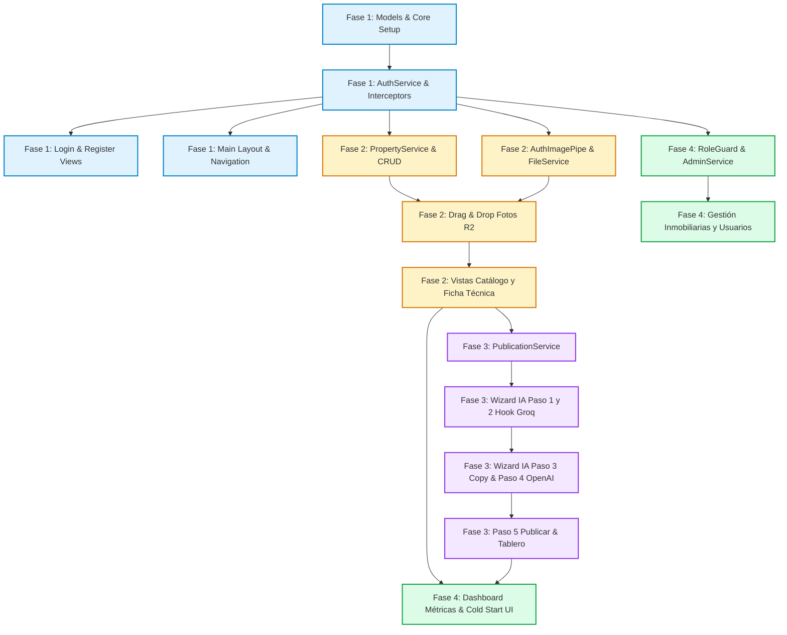

# 🗺️ InmoMarketing - Roadmap de Desarrollo y División de Tareas del Equipo

> **Proyecto:** InmoMarketing Frontend (Angular 22+ Standalone + Signals + Tailwind CSS)  
> **Fase Actual:** Fase 0 - Planificación, Arquitectura y Asignación de Tareas  
> **Repositorio Backend:** `https://github.com/marianoqqq/Marketing-Gestor`  

---

## 📑 Tabla de Contenidos
1. [Hoja de Ruta por Fases (Milestones)](#1-hoja-de-ruta-por-fases-milestones)
2. [Estrategia de Colaboración y Prevención de Conflictos en Git](#2-estrategia-de-colaboración-y-prevención-de-conflictos-en-git)
3. [Matriz de Roles y Asignación Sugerida de Integrantes](#3-matriz-de-roles-y-asignación-sugerida-de-integrantes)
4. [Diagrama de Dependencias Técnicas entre Tareas](#4-diagrama-de-dependencias-técnicas-entre-tareas)
5. [Checklist Maestro Granular de Tareas (`- [ ]`)](#5-checklist-maestro-granular-de-tareas--)
   - [Fase 1: Core, Seguridad, Interceptores y Layout Base](#fase-1-core-seguridad-interceptores-y-layout-base)
   - [Fase 2: Módulo de Propiedades y Galería Multimedia (Cloudflare R2)](#fase-2-módulo-de-propiedades-y-galería-multimedia-cloudflare-r2)
   - [Fase 3: Módulo de Publicaciones y Wizard Creador con IA (Groq + OpenAI)](#fase-3-módulo-de-publicaciones-y-wizard-creador-con-ia-groq--openai)
   - [Fase 4: Panel de Administración, Dashboard de Métricas y Pulido UI/UX](#fase-4-panel-de-administración-dashboard-de-métricas-y-pulido-uiux)

---

## 1. Hoja de Ruta por Fases (Milestones)

```
┌────────────────────────────────────────────────────────────────────────┐
│                        CRONOGRAMA DE ENTREGAS                          │
└────────────────────────────────────────────────────────────────────────┘
  ▼
[ FASE 1: Cimientos y Autenticación ] ──── Semanas 1 - 2
  - Configuración Tailwind, fuentes y tema visual.
  - Modelos TypeScript modulares por dominio (`src/app/core/models/`).
  - Servicios de Auth, Interceptores HTTP (JWT, Refresh con RxJS, Cold Start).
  - Vistas de Login, Registro y Layout principal (Sidebar + Navbar).
  ▼
[ FASE 2: Propiedades y Cloudflare R2 ] ── Semanas 2 - 3
  - PropertyService y PropertyFilesService.
  - AuthImagePipe para visualización segura de blobs R2.
  - Drag & Drop Uploader para fotos (multipart/form-data).
  - Vistas: Catálogo de propiedades, Alta/Edición reactiva y Ficha técnica.
  ▼
[ FASE 3: Publicaciones y Wizard IA ] ──── Semanas 3 - 4
  - PublicationService con endpoints de Groq y OpenAI.
  - Wizard Creador interactivo en 5 pasos (`/publicaciones/crear/:propiedadId`).
  - Generación de copys para redes sociales y ganchos de flyers.
  - Tablero Kanban/Listado de publicaciones con estados.
  ▼
[ FASE 4: Administración y Pulido ] ───── Semana 5
  - AdminService y RoleGuard (`ROLE_ADMIN`).
  - Vistas de control: Inmobiliarias y Bloqueo/Desbloqueo de usuarios.
  - Dashboard con métricas globales.
  - Banner de Cold Start, Toasts de notificación y auditoría de accesibilidad.
```

---

## 2. Estrategia de Colaboración y Prevención de Conflictos en Git

Para garantizar que múltiples desarrolladores trabajen en paralelo sin generar conflictos de merge destructivos, aplicaremos las siguientes reglas:

### 2.1 El "Contrato de Datos Primero" (Shared Types First)
- Todo el equipo debe consensuar y congelar los modelos en `src/app/core/models/` antes de escribir componentes.
- Si un desarrollador necesita agregar un tipo auxiliar específico de su vista, lo colocará en la carpeta interna de su feature (ej. `features/properties/models/property-filter.model.ts`), sin alterar el modelo core central salvo autorización del Lead Técnico.

### 2.2 Modularización Aislada por Dominio de Feature
- Cada integrante trabajará enfocado en su área:
  - **Santi:** `src/app/core/`, `layout/` y `shared/` (Líder Técnico & Core Architect)
  - **Seba:** `src/app/features/properties/` y galería multimedia Cloudflare R2
  - **Marian:** `src/app/features/publications/` (Wizard interactivo con IA, Groq/OpenAI) y sincronización con API
  - Módulos de administración y dashboard coordinados entre el equipo.
- Los archivos compartidos (`shared/components`, `core/services`) no se tocan sin avisar previamente por canal de comunicación.

### 2.3 Estrategia de Ramas Git (GitFlow Simplificado)
- **`main`**: Rama protegida de producción. Despliegue automático a hosting.
- **`develop`**: Rama base de integración diaria. Todo pull request se abre contra `develop`.
- **`feature/<modulo>-<descripcion-corta>`**: Ramas individuales de trabajo:
  - `feature/auth-refresh-interceptor`
  - `feature/properties-drag-drop`
  - `feature/wizard-ia-step1-step2`
  - `feature/admin-user-block`
- **`fix/<descripcion-corta>`**: Ramas de corrección puntual de bugs detectados en `develop`.

### 2.4 Reglas de Pull Request (PR) y Code Review
1. Máximo 350-400 líneas de cambio por PR para facilitar la revisión rápida.
2. Todo PR debe ser revisado y aprobado por al menos 1 compañero antes de integrarse.
3. Se utilizará `git rebase origin/develop` antes de solicitar el merge para mantener un historial lineal y limpio.
4. Mensajes de commit bajo el estándar **Conventional Commits**:
   - `feat(auth): add refresh token handler in interceptor`
   - `fix(properties): validate max 5mb per image in dropzone`
   - `style(wizard): improve social network card hover effect`

---

## 3. Matriz de Roles y Asignación de Integrantes

Esta estructura organiza las responsabilidades del equipo de trabajo:

| Rol Asignado | Responsable | Módulos y Carpetas a Cargo | Dependencias Clave |
|---|---|---|---|
| **Líder Técnico & Core Architect** | **Santi** | `src/app/core/`<br>`src/app/layout/`<br>`src/app/shared/components/toast/`<br>`src/app/core/http/` | Define interceptores, layout general, autenticación y maneja el Cold Start de Render. |
| **Ingeniero de Propiedades & R2** | **Seba** | `src/app/features/properties/`<br>`src/app/shared/components/drag-drop/`<br>`authImagePipe` | Depende de la base de autenticación para consumir `/api/propiedades` y `/api/archivos`. |
| **Ingeniero de Publicaciones & IA** | **Marian** | `src/app/features/publications/` (Wizard interactivo de 5 pasos, tablero de estados y detalle) | Consume `PropertyService` para asociar fotos y datos de inmuebles a los prompts de Groq/OpenAI. |
| **Ingeniero de Administración & UI/UX** | **Equipo (Santi / Seba / Marian)** | `src/app/features/admin/`<br>`src/app/features/dashboard/`<br>`src/app/shared/components/metrics/` | Depende de `roleGuard` y de los modelos consolidados de usuarios e inmobiliarias. |

---

## 4. Diagrama de Dependencias Técnicas entre Tareas



---

## 5. Checklist Maestro Granular de Tareas (`- [ ]`)

---

### Fase 1: Core, Seguridad, Interceptores y Layout Base

#### 1. Configuración de Entorno y Arquitectura Base
- [ ] Configurar variables de entorno en `src/environments/environment.ts` (`production: false`, `apiUrl: 'http://localhost:8080'`) y `environment.prod.ts` (`apiUrl: 'https://inmo-marketing-api.onrender.com'`).
- [ ] Instalación y gestión de dependencias oficiales con Bun: `bun add howler motion lenis html-to-image @angular/cdk ngx-sonner canvas-confetti material-symbols jwt-decode filepond filepond-plugin-image-preview filepond-plugin-file-validate-size filepond-plugin-file-validate-type` y `bun add -d @types/howler @types/canvas-confetti`.
- [ ] Configurar tipografía Google Fonts `Inter` e iconografía `Google Material Symbols` en `index.html` con clases de soporte de números tabulares (`tabular-nums`) y directivas de Tailwind en `styles.css`.
- [ ] Configurar e inicializar el proveedor de notificaciones `Ngx-Sonner` en `src/app/app.config.ts`.
- [x] Crear los modelos modulares de tipos e interfaces TypeScript en `src/app/core/models/` (`auth`, `propiedad`, `publicacion`, `inmobiliaria`, `archivo`, `user`, `error`, `index.ts`).

#### 2. Servicios de Autenticación, Almacenamiento Seguro y Preferencias
- [ ] Implementar `TokenStorageService` para lectura/escritura segura de `accessToken` y `refreshToken` en `localStorage`.
- [ ] Crear función auxiliar `decodeJwtPayload(token: string)` utilizando **`jwt-decode`** para extraer de forma segura y tipada los roles (`ROLE_USER` / `ROLE_ADMIN`), fecha de expiración e ID de usuario.
- [ ] Implementar `AuthService` utilizando Angular Signals (`currentUser = signal<UserResponse | null>(null)`, `isAuthenticated = computed(...)`).
- [ ] Codificar métodos en `AuthService`: `login(credentials)`, `register(data)`, `refreshAccessToken()`, `logout()`, `hasRole(role)`.
- [ ] Implementar `SoundService` con **Howler.js** para clips de audio sutiles (clics táctiles, chimes de éxito, avisos de error) gobernado por signal `isSoundEnabled = signal(true)` con toggle accesible en navbar/perfil.
- [ ] Implementar `ThemeService` para alternar entre Modo Claro y Modo Oscuro con persistencia en `localStorage`.

#### 3. Interceptores HTTP Funcionales
- [ ] Implementar `authInterceptor` (`HttpInterceptorFn`) que inyecte `Authorization: Bearer <accessToken>` en todas las peticiones dirigidas a `/api/**`.
- [ ] Implementar la lógica de captura de error 401 con `BehaviorSubject<string | null>` para encolar peticiones concurrentes, ejecutar `/auth/refresh` y reintentar la llamada original.
- [ ] Implementar `coldStartInterceptor` con `race` y `timer(4000)` para detectar si el backend Render Free demora más de 4s en responder.
- [ ] Implementar `errorInterceptor` global para extraer mensajes del esquema `ErrorResponse` del backend y emitirlos al sistema de notificaciones.
- [ ] Registrar todos los interceptores en `src/app/app.config.ts` mediante `provideHttpClient(withInterceptors([...]))`.

#### 4. Guards de Navegación y Control de Acceso
- [ ] Crear `authGuard` funcional para restringir rutas privadas si no existe token válido.
- [ ] Crear `guestGuard` funcional para redirigir al dashboard si un usuario ya autenticado intenta abrir `/login` o `/register`.
- [ ] Crear `roleGuard` funcional para proteger rutas administrativas verificando el claim `ROLE_ADMIN` en el token.

#### 5. Layout Base y Vistas de Autenticación
- [ ] Diseñar el componente `LoginComponent` con `ReactiveFormsModule`, validaciones de email/contraseña y loader interactivo.
- [ ] Diseñar el componente `RegisterComponent` con alta simultánea de usuario y nombre de inmobiliaria.
- [ ] Diseñar el layout maestro `MainLayoutComponent` compuesto por:
  - Sidebar lateral con links activos (`routerLinkActive`), colapsable en pantallas pequeñas.
  - Navbar superior con nombre de la inmobiliaria activa, rol del usuario y botón de logout.
  - Contenedor con `<router-outlet />` fluido.
  - Componente banner de Cold Start (`<app-cold-start-banner />`) condicionado al signal global.

---

### Fase 2: Módulo de Propiedades y Galería Multimedia (Cloudflare R2)

#### 1. Servicios y Pipes de Propiedades
- [ ] Implementar `PropertyService` con llamadas a:
  - `getProperties()`: `GET /api/propiedades`
  - `getPropertyById(id)`: `GET /api/propiedades/{id}`
  - `createProperty(data)`: `POST /api/propiedades`
  - `updateProperty(id, data)`: `PUT /api/propiedades/{id}`
  - `deleteProperty(id)`: `DELETE /api/propiedades/{id}`
- [ ] Implementar `PropertyFilesService`:
  - `getPropertyPhotos(propertyId)`: `GET /api/propiedades/{id}/fotos`
  - `uploadPropertyPhotos(propertyId, files)`: `POST /api/propiedades/{id}/fotos` con `FormData` (campo `'fotos'`).
- [ ] Implementar `AuthImagePipe` (`authImage`):
  - Descarga mediante `HttpClient` con `{ responseType: 'blob' }` inyectando credenciales.
  - Conversión a Object URL (`URL.createObjectURL(blob)`) y sanitización con `DomSanitizer`.
  - Liberación de memoria en ciclo de vida `ngOnDestroy`.

#### 2. Componentes Reutilizables de Propiedades
- [ ] Implementar componente Standalone de carga `FilePondUploaderComponent` (o `DragDropUploaderComponent` con FilePond):
  - Integración de FilePond con `filepond-plugin-image-preview` para miniaturas animadas de fotos.
  - Validación estricta con `filepond-plugin-file-validate-size` (máximo 5 MB por imagen).
  - Validación de extensiones permitidas con `filepond-plugin-file-validate-type` (`.jpg`, `.jpeg`, `.png`, `.webp`).
  - Empaquetado automático en `FormData` bajo la clave `'fotos'` y feedback de carga conectado a `PropertyFilesService`.
- [ ] Crear componente `PropertyCardComponent` para renderizar el resumen de un inmueble (foto principal, precio con formato de moneda, ambientes, m², badge de operación y estado).

#### 3. Pantallas del Módulo de Propiedades
- [ ] Construir vista `PropertyListComponent` (`/propiedades`):
  - Barra de búsqueda por texto (título, dirección).
  - Filtros reactivos por `TipoPropiedad`, `TipoOperacion` y `EstadoPropiedad`.
  - Controles de ordenamiento dinámico (precio ascendente/descendente, fecha de publicación, metros cuadrados).
  - Botón de acceso directo *"Nueva Propiedad"*.
  - Estado vacío (*Empty State*) amigable cuando no haya resultados.
- [ ] Construir vista `PropertyFormComponent` (`/propiedades/nueva` y `/propiedades/:id/editar`):
  - Formulario reactivo con validaciones estrictas: campos obligatorios, valores numéricos positivos para precio y dimensiones.
  - Modo dual (Creación / Edición) detectado por parámetro de ruta `:id`.
- [ ] Construir vista `PropertyDetailComponent` (`/propiedades/:id`):
  - Ficha técnica completa con especificaciones edilicias y cálculo automático de costo por metro cuadrado.
  - Galería visual de fotografías servidas desde Cloudflare R2 con selector de foto de portada.
  - Modal de visualización en pantalla completa (`PropertyGalleryLightboxComponent`) con zoom de alta definición.
  - Acceso directo a la acción: *"Generar Anuncio con IA para esta Propiedad"*.
  - Modal de confirmación para eliminar la propiedad.

---

### Fase 3: Módulo de Publicaciones y Wizard Creador con IA (Groq + OpenAI)

#### 1. Servicio de Publicaciones
- [ ] Implementar `PublicationService` con los siguientes métodos:
  - `getPublications()`: `GET /api/publicaciones`
  - `getPublicationById(id)`: `GET /api/publicaciones/{id}`
  - `createPublicationDraft(request)`: `POST /api/publicaciones`
  - `suggestHookText(id)`: `POST /api/publicaciones/{id}/sugerir-texto-imagen`
  - `updateHookAndStyle(id, texto, estilo)`: `PATCH /api/publicaciones/{id}/texto-imagen` con `HttpParams`.
  - `generateCopy(id)`: `POST /api/publicaciones/{id}/generar`
  - `generateImage(id)`: `POST /api/publicaciones/{id}/generar-imagen`
  - `markAsPublished(id)`: `POST /api/publicaciones/{id}/publicada`
  - `deletePublication(id)`: `DELETE /api/publicaciones/{id}`

#### 2. Componentes del Wizard Interactivo (`/publicaciones/crear/:propiedadId`)
- [ ] Diseñar el contenedor maestro `WizardCreatorComponent`:
  - Stepper visual responsivo con 5 etapas numeradas e indicadores de progreso.
  - Manejo del estado compartido del wizard usando Angular Signals.
- [ ] **Paso 1: Configuración de Base** (`Step1BaseComponent`):
  - Visualización resumida de la propiedad seleccionada.
  - Cuadrícula con las fotos del inmueble con checkboxes para seleccionar `fotoIds`.
  - Selector de `RedSocial` mediante cards interactivas (Instagram y Facebook).
  - Selector de `Formato` optimizado (Imagen comercial).
  - Botón para persistir el borrador inicial (`POST /api/publicaciones`).
- [ ] **Paso 2: Gancho Comercial / Hook** (`Step2HookComponent`):
  - Botón ✨ *"Sugerir gancho con IA"* (`POST /.../sugerir-texto-imagen`).
  - Textarea reactivo para ajustar manualmente el texto del flyer.
  - Selector visual de estilo artístico de la imagen.
  - Persistencia de datos mediante el método PATCH con query params.
- [ ] **Paso 3: Redacción del Post con Groq** (`Step3CopyComponent`):
  - Input para indicaciones o instrucciones particulares del agente.
  - Contador interactivo de caracteres con advertencias de límite según la red social seleccionada.
  - Botón 🚀 *"Redactar anuncio completo con IA"* (`POST /.../generar`).
  - Animación de carga inteligente durante la generación con Llama 3 y chime armónico de Howler.js al finalizar.
  - Visor del copy final con formateo de emojis y hashtags, y opción de regeneración parcial.
  - Botón interactivo *"Copiar al portapapeles"* con confirmación visual de Ngx-Sonner y audio sutil.
- [ ] **Paso 4: Generación Visual de Flyer con OpenAI o Exportación HTML** (`Step4ImageComponent`):
  - Botón 🎨 *"Diseñar imagen con IA"* (`POST /.../generar-imagen`).
  - Vista previa de la imagen generada servida mediante `AuthImagePipe` desde R2.
  - Maqueta de previsualización fidedigna que simula el feed de la red social de destino (Instagram o Facebook).
  - Exportación de flyer client-side con **html-to-image** a PNG/JPEG para descarga instantánea en alta resolución.
  - Botón de descarga local del archivo de imagen generado.
- [ ] **Paso 5: Revisión y Publicación** (`Step5PublishComponent`):
  - Vista previa general (mockup) del anuncio completo integrado.
  - Botón de acción definitiva: *"Marcar como publicada"* (`POST /.../publicada`).
  - Disparo de animación celebratoria con **Canvas Confetti** y audio de éxito.
  - Redirección triunfal al listado general de publicaciones.

#### 3. Tablero y Detalle de Publicaciones
- [ ] Construir vista `PublicationListComponent` (`/publicaciones`):
  - Filtros por estado: `BORRADOR`, `LISTA`, `PUBLICADA`, `ERROR`.
  - Tarjetas con badges de la red social correspondiente, fecha y vista resumida.
  - Acciones rápidas: ver detalle, reanudar wizard inconcluso, eliminar publicación.
- [ ] Construir vista `PublicationDetailComponent` (`/publicaciones/:id`):
  - Ficha consolidada con el texto completo, imagen asociada y metadatos de publicación.

---

### Fase 4: Perfil Inmobiliaria, Panel de Administración, Dashboard y Pulido UI/UX

#### 1. Perfil Corporativo de Inmobiliaria
- [ ] Implementar `InmobiliariaService`:
  - `getProfile()`: `GET /api/inmobiliaria`
  - `updateProfile(data)`: `PUT /api/inmobiliaria`
- [ ] Construir vista `InmobiliariaProfileComponent` (`/perfil-inmobiliaria`):
  - Formulario reactivo para nombre, teléfono, cuenta de Instagram, dirección y URL de logotipo.

#### 2. Panel de Administración (`ROLE_ADMIN`)
- [ ] Implementar `AdminService`:
  - `getAgencies()`: `GET /api/admin/inmobiliarias`
  - `blockUser(userId)`: `PATCH /api/admin/usuarios/{id}/bloquear`
  - `activateUser(userId)`: `PATCH /api/admin/usuarios/{id}/activar`
  - `getUsers()`, `createUser()`, `updateUser()`, `deleteUser()`: CRUD `/api/users`
- [ ] Construir vista `AgencyListComponent` (`/admin/inmobiliarias`):
  - Tabla estilizada con listado de inmobiliarias, fecha de alta y volumen de usuarios.
- [ ] Construir vista `UserManagementComponent` (`/admin/usuarios`):
  - Búsqueda de usuarios por nombre o email.
  - Badge visual de estado (`ACTIVE` verde / `BLOCKED` rojo).
  - Botones de acción inmediata para bloquear o reactivar el acceso de un usuario.
  - Modales para alta, edición y baja de usuarios.

#### 2. Dashboard y Métricas
- [ ] Construir vista `DashboardComponent` (`/dashboard`):
  - Tarjetas de métricas rápidas (total de propiedades disponibles, publicaciones creadas, publicaciones listas para salir).
  - Carrusel o lista de accesos directos (*"Cargar nueva propiedad"*, *"Crear publicación con IA"*).
  - Feed de publicaciones recientes.

#### 3. Pulido UI/UX, Accesibilidad y Control de Errores
- [ ] Implementar `NotificationToastComponent` con soporte para mensajes de éxito, advertencia y error extraídos de `ErrorResponse`.
- [ ] Refinar transiciones y microinteracciones de Tailwind CSS (hover effects, focus ring en inputs accesibles).
- [ ] Validar compatibilidad en dispositivos móviles, tablets y navegadores principales (Chrome, Firefox, Edge, Safari).
- [ ] Realizar pruebas integradas de flujo de token refresh y simulación de caída de red.
